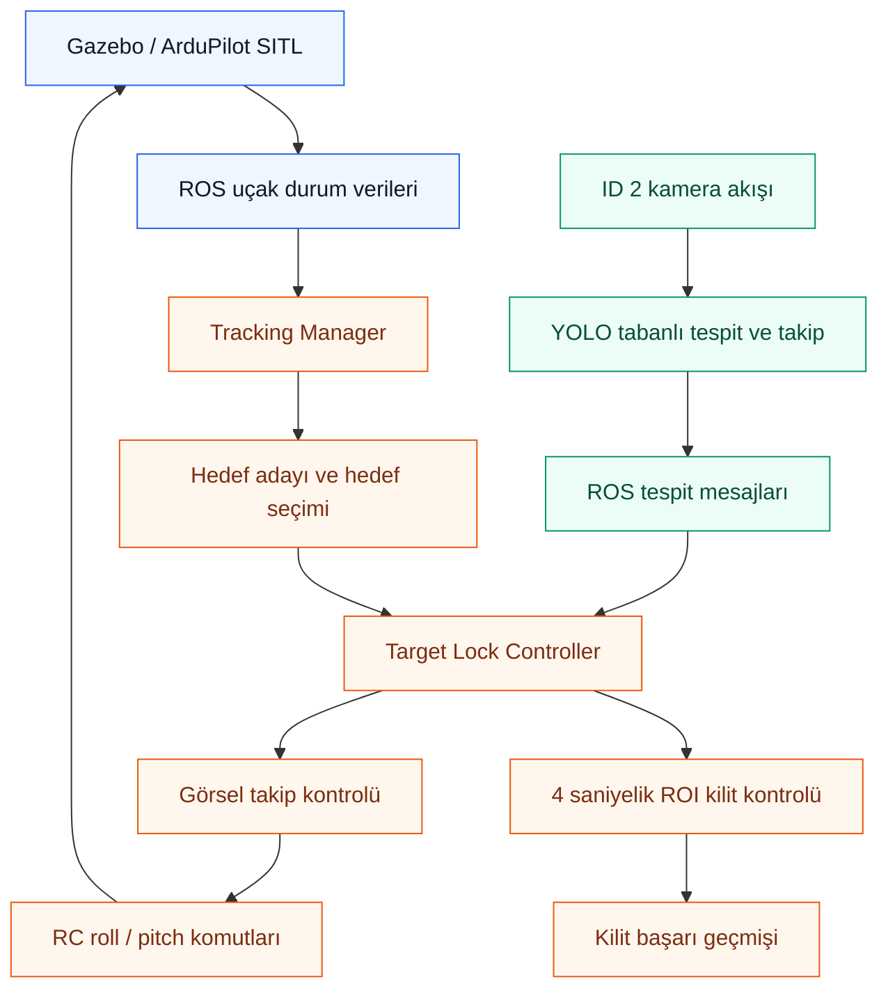

<div align="center">

# VISTRALOCK

### Gerçek Zamanlı İHA Hedef Takibi ve Görsel Kilitlenme Sistemi

**Real-Time UAV Target Tracking & Visual Lock-On System**

**Vision · Tracking · Lock-On**

*ROS, Gazebo ve ArduPilot SITL üzerinde geliştirilen; hedef seçimi, görüntü tabanlı takip ve koşula bağlı kilitlenme mantığını bir araya getiren modüler bir İHA yazılım projesi.*


</div>

---

## Proje Hakkında

**VISTRALOCK**, simülasyon ortamındaki bir İHA'nın diğer hava aracını belirlemesi, uygun hedefi seçmesi, kamera görüntüsünden takip etmesi ve tanımlı şartlar sağlandığında **görsel kilitlenme** gerçekleştirmesi için geliştirilen bir sistemdir.

Proje yalnızca görüntü üzerinde nesne kutusu çizmeye odaklanmaz. **Uçuş verisi, hedef yönetimi, görüntü tabanlı takip ve kontrol komutları** arasındaki veri akışını birlikte ele alır.

Geliştirme ortamında iki Mini Talon modeli kullanılır:

| Sistem kimliği | Gazebo modeli | Rol |
| --- | --- | --- |
| **ID 1** | `mini_talon_clean` | Takip edilecek hava aracı |
| **ID 2** | `mini_talon_2` | Kendi İHA'mız; kamera ve takip kontrolü |

> [!NOTE]
> **Bu depo bir kaynak kod portföyüdür.** Projenin seçilmiş algoritmalarını, ROS servislerini, arayüz bileşenlerini ve simülasyon betiklerini içerir. Tam çalışan uygulamanın bütün dosyalarını veya eğitilmiş modeli içerdiği iddia edilmez.

## Temel Yetkinlikler

| Alan | Geliştirilen işlev |
| --- | --- |
| **Hedef yönetimi** | İHA durumlarından hedef adayı oluşturma, seçim ve takip durumunu yönetme |
| **Görüntü tabanlı takip** | Tespit kutusu, merkez konumu ve takip kimliği üzerinden hedefi izleme |
| **Kayıp hedef yönetimi** | Kısa süreli tespit kayıplarında yeniden yakalama ve gerektiğinde kontrolü nötrleme |
| **Görsel kilitlenme** | Hedefin belirlenmiş görüntü bölgesinde kesintisiz kalmasını zamana bağlı doğrulama |
| **Tekrar kilit önleme** | Başarıyla kilitlenen hedefin tekrar başarı üretmesini engellemek için kimlik geçmişi tutma |
| **İHA kontrolü** | Görsel hata bilgisine göre roll/pitch kontrol komutu üretme ve iletme |
| **Simülasyon** | Gazebo, ArduPlane SITL ve MAVProxy ile çoklu araç başlatma ve uçuş senaryoları |
| **ROS entegrasyonu** | Kamera, tespit sonuçları ve uçak durum verilerinin modüller arasında taşınması |

## Sistem Mimarisi



**İki farklı bilgi kaynağı birlikte kullanılır:** Simülasyondan gelen uçak durum verileri hedefin uçuş bağlamını sağlar; kamera üzerindeki tespitler ise görsel takibi ve ROI kilit kontrolünü besler.

> Diyagram, geliştirilen sistemin genel mimarisini gösterir. YOLO çalıştırma modülü ve tam dashboard bu portföy deposunda bulunmaz.

## Görsel Kilitlenme Algoritması

Görsel kilitlenme, ekranda bir hedef tespit edilmesiyle **hemen başarılı sayılmaz**. Hedefin, kamera görüntüsünde tanımlanan sarı **ROI (Region of Interest)** alanının içinde yeterli oranda bulunması ve bu koşulu gerekli süre boyunca sağlaması gerekir.

| Parametre | Değer | Açıklama |
| --- | --- | --- |
| Yatay ROI kenar payı | `%25` (her iki yan) | Görüntünün orta bölümünü sınırlar |
| Dikey ROI kenar payı | `%10` (üst/alt) | Görsel takip bölgesini belirler |
| Minimum kutu kapsama oranı | `%90` | Hedef tespit kutusunun ROI içinde kalan oranı |
| Gerekli kilitlenme süresi | **4 saniye** | Başarı için gerekli süreklilik |

**Kilitlenme akışı:**

1. Hedefin geçerli tespit kutusu alınır.
2. Kutunun ROI içindeki kapsama oranı hesaplanır.
3. Hedef ve ROI koşulları geçerliyse süre takibi yapılır.
4. Hedef kaybolduğunda veya gerekli koşullar bozulduğunda kilit ilerlemesi ilgili kurallara göre sıfırlanır.
5. Koşullar **4 saniye** sağlandığında kilitlenme başarılı kabul edilir ve hedef başarı geçmişine eklenir.

### Takip ID'si neden yeterli değil?

Görüntü tabanlı takip algoritmalarında `track_id`, fiziksel hava aracının değişmez kimliği değildir. Görsel takip kısa süreli koptuğunda aynı İHA farklı bir takip ID'si alabilir. Bu durum, aynı hedef için tekrar kilitlenme başlatılması riskini oluşturur.

Bu problemi azaltmak için `TargetLockController` içerisinde:

- Başarılı kilitlenme geçmişi tutulur.
- **Sistem/uçak kimliği** ile **görüntü takip kimliği** birbirinden ayrı değerlendirilir.
- Kısa süreli ID değişimlerinde, geçmiş hedefin son konumu ve tespit kutusu bilgileri kullanılarak yeniden eşleştirme denenir.
- Aynı hedefe ait olduğu belirlenen yeni takip ID'si için mükerrer kilit başarısı engellenir.

> [!IMPORTANT]
> Konum ve kutu benzerliğine dayanan kısa süreli yeniden eşleştirme **kesin fiziksel kimlik doğrulaması değildir**. Birbirine yakın iki İHA veya uzun süreli görüntü kaybı gibi durumlar hâlâ zorlayıcıdır. Bu, üzerinde çalışılan bir bilgisayarlı görü problemidir.

## Hedef Kaybı ve Yeniden Yakalama

Görsel takip sistemi, hedefin anlık olarak kaybolmasına karşı durum tabanlı çalışır:

```text
SEARCHING → LOCKING → TRACKING
                       │
                       ├── Hedef tespit ediliyor → Takibe devam
                       │
                       └── Hedef kayboldu
                                ↓
                           REACQUIRING
                                │
                       ┌────────┴────────┐
                       ↓                 ↓
                 Hedef bulundu      Hedef bulunamadı
                       ↓                 ↓
                    TRACKING        Güvenli kontrol davranışı
```

Takip kontrolü ile **4 saniyelik ROI başarısı farklı aşamalardır**. Takip hedefinin edinilmesi, tek başına kilit başarısı anlamına gelmez.

## Kullanılan Teknolojiler

| Katman | Teknoloji / araç | Amaç |
| --- | --- | --- |
| Programlama | Python | Algoritmalar ve modüller |
| Robotik haberleşme | ROS Noetic, `rospy` | Kamera, durum ve tespit mesajları |
| Simülasyon | Gazebo Classic 11 | Uçuş ortamı ve araç durumları |
| Uçuş kontrolü | ArduPilot ArduPlane SITL | Uçuş dinamikleri ve kontrol |
| MAVLink araçları | MAVProxy | Telemetri ve kontrol bağlantısı |
| Bilgisayarlı görü | OpenCV, Ultralytics YOLO | Yerel sistemde nesne tespiti |
| Çoklu nesne takibi | BoT-SORT / takip kimliği yönetimi | Görüntü üzerinde hedef sürekliliği |
| Masaüstü arayüz | PyQt5 | Yerel sistemin izleme ve kontrol ekranı |
| Süreç yönetimi | Bash, tmux | Çoklu SITL ve yardımcı süreçler |

## ROS Veri Akışı

Sistemde kullanılan önemli veri kanalları:

| Topic / kaynak | İçerik |
| --- | --- |
| `/mini_talon_2/front_camera/camera/image_raw` | Kendi İHA'mızın kamera görüntüsü |
| `/yolo/detections` | Tespit kutuları, sınıf, güven skoru ve geçici takip ID'si |
| `/gazebo/model_states` | Simülasyondaki araçların konum ve yönelim bilgileri |
| `/tracking/enabled` | Takip sisteminin etkinlik durumu |

Yerel tespit hattındaki ROS mesajları JSON biçiminde taşınır. Aşağıdaki örnek **temsili veridir**:

```json
{
  "detections": [
    {
      "class_id": 0,
      "class_name": "iha",
      "confidence": 0.91,
      "track_id": 12,
      "bbox": [220, 130, 350, 245]
    }
  ]
}
```

Buradaki `track_id: 12`, bir **görüntü takip numarasıdır**; `ID 1` veya `ID 2` gibi sistemdeki uçak kimliği değildir.

## Depodaki Kod Yapısı

```text
vistralock/
├── .gitignore
├── README.md
├── auto_takeoff.py                  # Simülasyonda otomatik kalkış
├── takeoff_all.sh                  # Çoklu İHA simülasyonunu başlatma
├── stop_talon.sh                  # Simülasyon süreçlerini durdurma
├── throttle_bridge.py             # Kontrol ve simülasyon köprüsü
├── talon_defaults.parm            # ArduPlane başlangıç parametreleri
└── tracking/
    ├── main.py                     # Yerel uygulama giriş noktası
    ├── read_aircraft.py            # Uçak verilerini okuma
    ├── controllers/                # Hedef edinme, takip ve kilit mantığı
    │   ├── acquire_controller.py
    │   ├── target_lock_controller.py
    │   ├── tracking_controller.py
    │   └── visual_tracking_controller.py
    ├── managers/                   # Takip durumu ve iş akışı yönetimi
    │   ├── tracking_manager.py
    │   └── visual_tracking_manager.py
    ├── models/                     # Uçak durumları ve takip metrikleri
    │   ├── aircraft_state.py
    │   └── tracking_metrics.py
    ├── services/                   # ROS veri sağlayıcıları ve kontrol
    │   ├── ownship_control_service.py
    │   ├── ros_aircraft_provider.py
    │   ├── ros_camera_provider.py
    │   ├── ros_detection_provider.py
    │   └── ros_multi_aircraft_provider.py
    └── ui/
        └── widgets/               # PyQt5 arayüz bileşenleri
            ├── active_tracking_panel.py
            ├── camera_feed.py
            ├── candidate_panel.py
            ├── online_indicator.py
            ├── ownship_control_panel.py
            ├── status_badge.py
            └── target_info_panel.py
```

> Bu liste, GitHub portföyüne eklenen kaynak kodlarını gösterir. `__init__.py` dosyaları görünümü sadeleştirmek için listelenmemiştir. `tactical_map.py`, YOLO dedektörü, YOLO süreç servisi, tam dashboard ve `.pt` model ağırlıkları bu paylaşımda yer almaz.

## Depo Kapsamı ve Sınırlamalar

Bu GitHub deposunun amacı, **mühendislik yaklaşımımı ve geliştirdiğim kaynak kodları incelemeye açmaktır**. Bu nedenle depo:

- Hedef takibi, kilitlenme ve durum yönetimi algoritmalarını içerir.
- Uçuş simülasyonu, ROS veri sağlayıcıları, kontrol ve PyQt5 arayüz bileşenlerinden seçilmiş kaynak kodları içerir.
- **Eğitilmiş YOLO model ağırlıklarını (`.pt`) ve eğitim veri setlerini içermez.**
- Yerel uygulamanın tam PyQt5 dashboard'unu ve YOLO çalıştırma servislerini içermez.
- Tek başına kurulabilir, eksiksiz veya çalıştırılması doğrulanmış bir ürün olarak sunulmaz.

Bu ayrım bilinçlidir: **Depo, kurulum paketi değil; yazılım geliştirme ve problem çözme çalışmalarının teknik portföyüdür.**

## Teknik Geliştirme Alanları

Projenin ilerleyen aşamaları için değerlendirilen başlıklar:

- Kamera takibi ile fiziksel uçak kimliği arasındaki eşleştirmeyi güçlendirmek.
- Hedef kimliği değişimi, hedefin kaybolması ve yeniden tespit edilmesi için tekrarlanabilir testler hazırlamak.
- Algılama ve kontrol hattında gecikme, kare hızı ve karar süresini ölçmek.
- Simülasyon senaryolarını ve çalışma ortamını daha kolay yeniden üretilebilir hâle getirmek.

## Lisans ve Haklar

Bu depoda **açık kaynak lisansı bulunmamaktadır (No License)**. Kodların GitHub üzerinde görüntülenebilir olması, genel kullanım, değiştirme veya yeniden dağıtma izni verildiği anlamına gelmez. GitHub'ın platform koşulları ve üçüncü taraf bileşenlerin kendi lisansları ayrıca geçerlidir.

**© 2026 Mert Özgökçeler. All rights reserved.**

---

<div align="center">

**VISTRALOCK** · Computer Vision · UAV Systems · ROS · Autonomous Tracking

*Bir tespit kutusundan daha fazlası: hedef yönetimi, görsel takip ve karar mantığı.*

</div>
